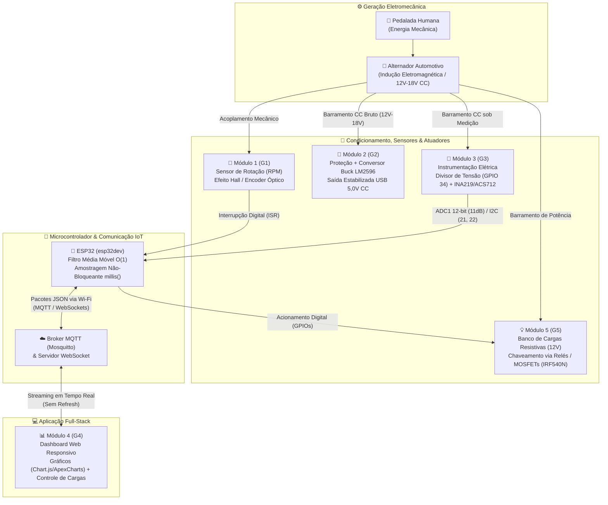

# 🚲⚡ Bicicleta Geradora de Energia & Telemetria Web/IoT


-00599C?style=for-the-badge)


---

## 1. Apresentação Institucional

| Campo | Descrição |
| :--- | :--- |
| **Projeto** | 🚲⚡ Bicicleta Geradora de Energia & Telemetria Web/IoT |
| **Instituição** | Instituto Federal do Acre (IFAC) — *Campus* Rio Branco |
| **Curso** | Técnico Integrado ao Ensino Médio em Informática para Internet (3º Ano) |
| **Disciplina** | Física Aplicada & IoT *(Prazo executivo: 4 Semanas)* |

### 🎯 Objetivo Geral
Conectar os princípios fundamentais do **Eletromagnetismo** e da **Eletrodinâmica** ao ecossistema moderno de **Desenvolvimento Web** e **Internet das Coisas (IoT)**. O sistema integrado captura sinais elétricos gerados pela energia mecânica da pedalada em uma bicicleta acoplada a um alternador automotivo, realiza o condicionamento e a regulação de potência (incluindo saída estabilizada USB 5,0V), processa leituras elétricas e mecânicas via microcontroladores **ESP32**, transmite telemetria sem fio (**MQTT / WebSockets**) em tempo real para um **Dashboard Web responsivo** e permite o acionamento remoto de um **banco de cargas resistivas**, alterando na prática o conjugado resistente (peso físico) da pedalada.

---

## 2. Arquitetura Global do Sistema e Os 5 Módulos Físico-Computacionais

### 🗺️ Fluxograma de Energia e Dados (Mermaid.js)



---

### 🔬 Detalhamento dos 5 Módulos do Projeto

#### 🔄 Módulo 1 (G1) — Sensor de Rotação (RPM) & Análise da Geradora
* **Fundamentação Física:** Baseia-se na **Lei da Indução de Faraday-Lenz**, segundo a qual a força eletromotriz induzida ($\mathcal{E}$) no estator do alternador é diretamente proporcional à taxa de variação temporal do fluxo magnético ($\Phi$):

$$\mathcal{E} = -\frac{d\Phi}{dt}$$

A frequência de rotação ($f$) e a velocidade angular em rotações por minuto ($\text{RPM}$) são determinadas a partir da contagem de pulsos ($n$) em uma janela de tempo ($\Delta t$) considerando o número de ímãs/fendas ($N_{\text{pulsos}}$) por volta:

$$f = \frac{n}{\Delta t} \quad \implies \quad \text{RPM} = \frac{n}{\Delta t \cdot N_{\text{pulsos}}} \times 60$$

* **Entregas de Hardware & Firmware:** Leitura de pulsos na roda/polia do alternador via **Sensor de Efeito Hall** ou **Encoder Óptico** conectado a pino com interrupção externa (`attachInterrupt` com `IRAM_ATTR`) no ESP32, cálculo de RPM com *debounce* por software e publicação em formato JSON via MQTT.

---

#### 🔋 Módulo 2 (G2) — Regulação de Tensão & Módulo de Carregamento (Eletrônica de Potência)
* **Fundamentação Física:** Transformação, proteção e regulação de potência elétrica em corrente contínua ($\eta = P_{\text{saida}} / P_{\text{entrada}}$) com chaveamento *step-down* (conversor CC-CC *Buck*), reduzindo a tensão de entrada ($12\text{ V}$ a $18\text{ V}$) para $5,0\text{ V}$ com alta eficiência energética e baixa dissipação térmica.
* **Entregas de Hardware:**
  * Recepção da tensão retificada instável do alternador ($12\text{ V}$ a $18\text{ V CC}$).
  * Estágio de proteção contra surtos, corrente reversa e sobretensão utilizando **Diodo Schottky/Zener** e **fusível rearmável (PTC)**.
  * Regulação DC-DC via módulo **LM2596** (*Buck Converter*) calibrado e estabilizado em **$5,0\text{ V CC}$** para alimentação segura e carregamento de dispositivos móveis via porta USB.

---

#### 📐 Módulo 3 (G3) — Instrumentação & Sensores de Medição Elétrica (Telemetria de Entrada)
* **Fundamentação Física:** Aplicação direta da **Lei de Ohm** ($U = R \cdot I$) e associação de resistores em série para condicionamento de sinais analógicos. Como o ADC do ESP32 opera com limite máximo de $3,3\text{ V}$ (faixa linear até $\approx 3,1\text{ V}$ na atenuação de $11\text{ dB}$), utiliza-se um divisor resistivo ($R_1 = 68\text{ k}\Omega$ e $R_2 = 10\text{ k}\Omega$) para mapear tensões de entrada de até **$25\text{ V CC}$** em uma saída máxima segura de $\approx 3,20\text{ V}$:

$$V_{\text{real}} = V_{\text{pino}} \cdot \left(\frac{R_1 + R_2}{R_2}\right) \cdot \text{CALIB}_{\text{V}}$$

* **Entregas de Hardware & Firmware:**
  * Leitura de tensão calibrada de fábrica no eFuse via `analogReadMilliVolts(34)` (`ADC1`, 12 bits, `ADC_11db`).
  * Medição de corrente elétrica em série de forma modular (`#define USE_INA219`), suportando tanto o sensor digital **INA219** (barramento I2C nos GPIOs `21` e `22`) quanto o sensor analógico de Efeito Hall **ACS712** (`GPIO 35` / `ADC1`).
  * Filtragem digital de ruído eletromecânico da pedalada por meio de um **Filtro de Média Móvel Circular de complexidade $O(1)$** (`MovingAverage.h`):

$$\bar{x}_k = \frac{1}{N} \sum_{i=0}^{N-1} x_{k-i}$$

com atualização em tempo constante $O(1)$:

$$S_k = S_{k-1} - x_{\text{antigo}} + x_{\text{novo}}$$

---

#### 📊 Módulo 4 (G4) — Aplicação Web & Dashboard Frontend (Full-Stack & WebSockets)
* **Fundamentação Física:** Integração numérica discreta da potência elétrica ao longo do tempo para obtenção do trabalho/energia convertida pela pedalada:

$$P(t) = U(t) \cdot I(t) \quad [\text{W}]$$

$$E = \int P \, dt \approx \sum P_k \cdot \Delta t \quad [\text{J}] \qquad \text{e} \qquad E_{\text{Wh}} = \frac{E_{\text{Joules}}}{3600} \quad [\text{Wh}]$$

Conversão equivalente em calorias mecânicas/metabólicas ($\text{kcal}$ considerando $1\text{ kcal} \approx 4184\text{ J}$).
* **Entregas de Software:**
  * **Broker MQTT (Mosquitto)** e ponte **WebSockets** recebendo os pacotes JSON publicados pelo ESP32.
  * Interface Web responsiva (**HTML5 / CSS3 / JavaScript + Chart.js / ApexCharts**) com atualização em tempo real sem *refresh* de página.
  * Exibição de velocímetro de RPM, curvas de Tensão ($V$), Corrente ($A$), Potência Instantânea ($W$), Energia Acumulada ($\text{J}$ e $\text{Wh}$), estimativa de calorias gastas e botões interativos para acionamento remoto do banco de cargas.

---

#### 💡 Módulo 5 (G5) — Banco de Cargas Resistivas & Efeito Joule
* **Fundamentação Física:** Aplicação das **Leis de Kirchhoff** (divisão de corrente em nós paralelos) e do **Efeito Joule**:

$$P_{\text{dissipada}} = R \cdot I^2 = \frac{U^2}{R_{\text{eq}}} \qquad \text{onde} \qquad \frac{1}{R_{\text{eq}}} = \sum_{i=1}^{n} \frac{1}{R_i}$$

Ao conectar novas cargas resistivas em paralelo no barramento do alternador, a resistência equivalente ($R_{\text{eq}}$) diminui, exigindo maior corrente induzida ($I$). Pela **Lei de Lenz**, a corrente mais elevada no induzido gera um conjugado eletromagnético opositor maior, tornando o pedal fisicamente mais pesado para o ciclista.
* **Entregas de Hardware & Firmware:** Associação de resistores de potência de fio/porcelana e/ou lâmpadas automotivas $12\text{ V}$ em paralelo, chaveados eletronicamente pelas GPIOs do ESP32 através de **Módulos Relé optoacoplados** ou **MOSFETs de potência (ex: IRF540N)** comandados remotamente pelo Dashboard Web.

---

## 3. Estrutura do Repositório e Mapeamento de Pinos (Pinout ESP32)

### 📁 Árvore de Diretórios do Projeto

```text
bicleta/
├── include/
│   └── MovingAverage.h          # Classe template de Filtro de Média Móvel Circular O(1) (Módulo G3)
├── src/
│   └── main.cpp                 # Firmware principal ESP32: ADC1, I2C, Simulador de Pedalada e Telemetria (G1/G3/G5)
├── web/                         # (Estrutura reservada - Módulo G4) Aplicação Web & Dashboard Full-Stack
│   ├── index.html               # Interface responsiva do Dashboard de Telemetria e Controle de Cargas
│   ├── css/
│   │   └── styles.css           # Estilização do painel e indicadores
│   └── js/
│       ├── app.js               # Cliente MQTT over WebSockets e cálculo de Energia (J/Wh) e Calorias
│       └── charts.js            # Configuração dos gráficos em tempo real (Chart.js / ApexCharts)
├── .gitignore                   # Regras de exclusão de artefatos de compilação (.pio, .vscode)
├── platformio.ini               # Configuração do ambiente PlatformIO (esp32dev, Arduino, Adafruit INA219)
└── README.md                    # Documentação geral integrada do projeto
```

---

### 📌 Tabela de Pinout Oficial do ESP32 (`esp32dev`)

> [!IMPORTANT]
> Todos os canais analógicos utilizam exclusivamente o periférico **ADC1 (GPIOs 32 a 39)** do ESP32, garantindo que a leitura analógica funcione simultaneamente com o transceptor **Wi-Fi** (que desabilita o `ADC2`).

| Pino ESP32 | Função / Periférico | Módulo | Direção | Descrição Técnica |
| :---: | :---: | :---: | :---: | :--- |
| **GPIO 34** | `ADC1_CH6` (12 bits, `11dB`) | **G3** | Entrada Analógica | Leitura de tensão do gerador via divisor resistivo ($R_1 = 68\text{ k}\Omega, R_2 = 10\text{ k}\Omega$, máx. $25\text{ V}$) |
| **GPIO 35** | `ADC1_CH7` (12 bits, `11dB`) | **G3** | Entrada Analógica | Leitura analógica de corrente via sensor **ACS712** (quando `USE_INA219` está desativado) |
| **GPIO 21** | `I2C SDA` | **G3** | Bidirecional | Linha de dados I2C para o sensor digital de corrente/potência **INA219** |
| **GPIO 22** | `I2C SCL` | **G3** | Saída (Clock) | Linha de clock I2C para o sensor digital de corrente/potência **INA219** |
| **GPIO 27** *(Reservado)* | `EXT_INT` (`IRAM_ATTR`) | **G1** | Entrada Digital | Pino de interrupção externa para o sensor de **RPM** (Efeito Hall / Encoder Óptico) |
| **GPIO 25** *(Reservado)* | `GPIO Digital / PWM` | **G5** | Saída Digital | Acionamento da **Carga Resistiva 1** (Relé Canal 1 / Gate MOSFET IRF540N) |
| **GPIO 26** *(Reservado)* | `GPIO Digital / PWM` | **G5** | Saída Digital | Acionamento da **Carga Resistiva 2** (Relé Canal 2 / Gate MOSFET IRF540N) |
| **GPIO 32** *(Reservado)* | `GPIO Digital / PWM` | **G5** | Saída Digital | Acionamento da **Carga Resistiva 3** (Relé Canal 3 / Gate MOSFET IRF540N) |

---

## 4. Como Executar o Projeto (Firmware PlatformIO + Web)

### 🛠️ 5.1. Compilando, Gravando e Monitorando o Firmware no ESP32

#### Pré-requisitos
* [VS Code](https://code.visualstudio.com/) com a extensão **PlatformIO IDE** instalada (ou PlatformIO Core CLI).
* Cabo USB de dados conectado à placa **ESP32 Dev Module (`esp32dev`)**.

#### Comandos Principais (Terminal PlatformIO)

```bash
# 1. Compilar o firmware para validar dependências e sintaxe
pio run

# 2. Compilar e gravar (upload) o firmware na placa ESP32 conectada via USB
pio run -t upload

# 3. Abrir o Monitor Serial em 115200 baud para visualizar a telemetria a cada 300 ms
pio device monitor -b 115200
```

#### ⚙️ Ajuste Rápido de Bancada e Modo de Simulação (`src/main.cpp`)
No topo do arquivo `src/main.cpp`, todas as constantes físicas e flags de operação estão agrupadas para ajuste imediato durante os testes de bancada:

```cpp
// true  -> Simula pedalada senoidal (12V-18V e 0.5A-2.5A) com ±8% de ruído branco
// false -> Lê os sensores físicos nos pinos do ESP32 (ADC1 / I2C)
#define SIMULATION_MODE true

// Comente para usar o sensor analógico ACS712 (GPIO 35) em vez do INA219 (I2C 21/22)
#define USE_INA219

// Constantes de calibração rápida com multímetro de bancada
constexpr uint8_t PIN_V = 34;      // Pino ADC de tensão (ADC1_CH6)
constexpr uint8_t PIN_I = 35;      // Pino ADC de corrente ACS712 (ADC1_CH7)
constexpr float R1      = 68000.0f; // Resistor superior (68 kOhm)
constexpr float R2      = 10000.0f; // Resistor inferior (10 kOhm)
float CALIB_V           = 1.000f;   // Ajuste fino: V_multimetro / V_lido
float ACS_OFFSET        = 1650.0f;  // Tensão quiescente (0A) em mV no GPIO 35
```

---

### 🌐 5.2. Iniciando o Broker MQTT / Servidor Web e o Dashboard *(Módulo G4)*

```bash
# 1. Iniciar o Broker Mosquitto com suporte a MQTT (porta 1883) e WebSockets (porta 9001)
mosquitto -c mosquitto.conf -v

# 2. Servir o diretório da aplicação Web localmente
cd web
npx serve -l 8080
# Ou utilizando Python 3:
python -m http.server 8080
```
* Em seguida, acesse `http://localhost:8080` no navegador para visualizar os gráficos de tensão, corrente, potência instantânea ($W$), energia acumulada ($\text{J} / \text{Wh}$) e acionar remotamente o banco de cargas resistivas.

---

## 5. Cronograma Executivo e Checkpoints (4 Semanas)

- [x] **Semana 1 — Arquitetura, Dimensionamento Elétrico & Estrutura de Software**
  - [x] Dimensionamento do divisor de tensão ($R_1 = 68\text{ k}\Omega, R_2 = 10\text{ k}\Omega$) para entrada de até $25\text{ V CC}$.
  - [x] Estruturação do projeto PlatformIO (`esp32dev`), implementação do filtro circular `MovingAverage.h` em $O(1)$ e gerador de simulação de pedalada (`SIMULATION_MODE`).
- [ ] **Semana 2 — Checkpoint 1: Validação de Bancada, Regulação 5V & Monitor Serial**
  - [ ] Montagem física e teste de bancada do conversor *Buck* LM2596 estabilizado em $5,0\text{ V CC}$ com circuito de proteção.
  - [ ] Aferição com multímetro e ajuste empírico de `CALIB_V` e `ACS_OFFSET` / `INA219_OFFSET_MA`.
  - [ ] Validação das curvas filtradas em tempo real a cada $300\text{ ms}$ no Monitor Serial / Serial Plotter (`115200` baud).
- [ ] **Semana 3 — Checkpoint 2: Telemetria Sem Fio (MQTT/WebSockets) & Dashboard em Tempo Real**
  - [ ] Integração do sensor de rotação (RPM) via interrupção externa no ESP32.
  - [ ] Transmissão sem fio de pacotes JSON via Wi-Fi para o Broker MQTT / WebSockets.
  - [ ] Recepção e plotagem em tempo real no Dashboard Web ($U, I, P, E_{\text{Joules}}, E_{\text{Wh}}$ e calorias).
- [ ] **Semana 4 — Integração Final sob Carga Real, Relatório Técnico & Apresentação Pública**
  - [ ] Acionamento remoto do Banco de Cargas Resistivas ($12\text{ V}$) via relés/MOSFETs a partir do Dashboard Web, demonstrando o aumento de peso na pedalada pelo Efeito Joule e Lei de Lenz.
  - [ ] Entrega do Relatório Técnico Experimental (3 páginas) com análise de eficiência e curvas coletadas.
  - [ ] Demonstração prática e Apresentação Pública no IFAC — *Campus* Rio Branco.

---

<div align="center">
  <sub>Desenvolvido pelos discentes do 3º Ano do Curso Técnico Integrado em Informática para Internet — <b>IFAC Campus Rio Branco</b>.</sub>
</div>

